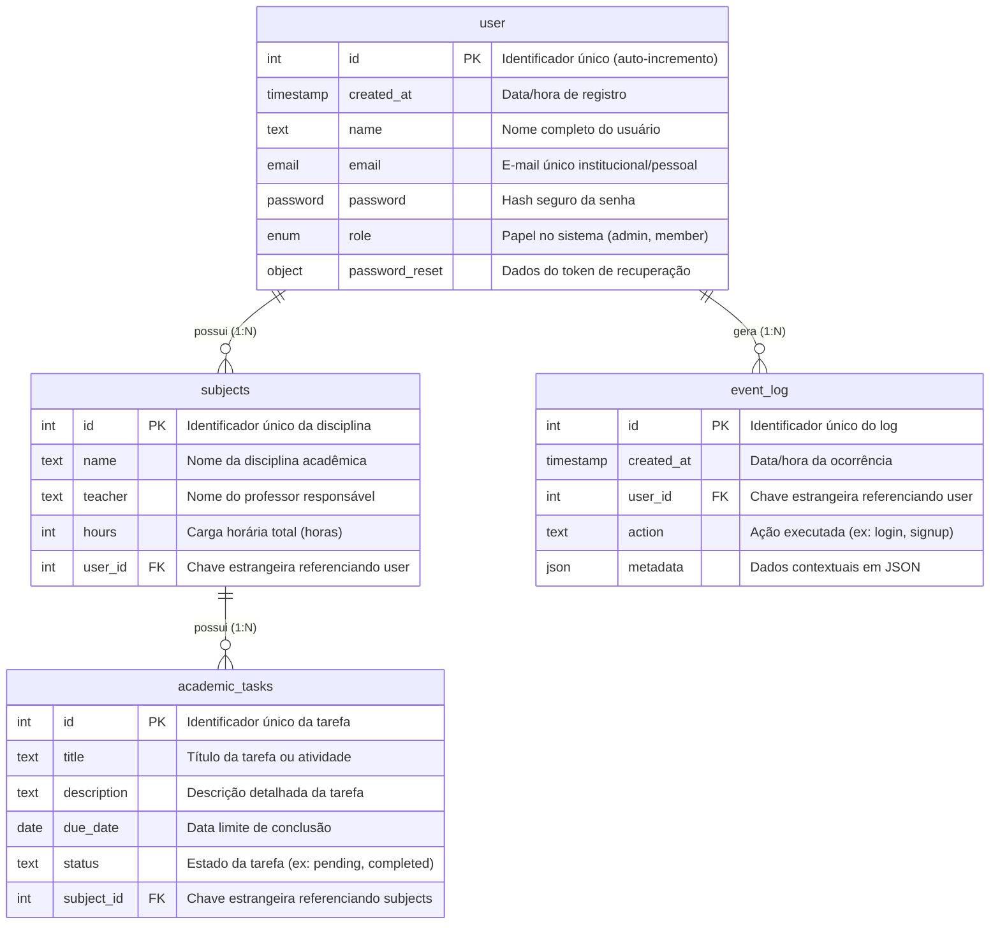

# Dicionário de Dados — EduTrack AI

Este documento estabelece o **Dicionário de Dados** formal da aplicação **EduTrack AI**, detalhando a estrutura do modelo relacional gerenciado no Xano, as regras de integridade referencial, os tipos de dados e os vínculos com as funcionalidades do sistema e do frontend (FlutterFlow).

---

## 1. Visão Geral e Diagrama de Entidades (DER)

O modelo de dados do EduTrack AI é composto por quatro tabelas principais no backend Xano:
1. `user`: Entidade central de autenticação e identificação de perfil dos estudantes/administradores.
2. `subjects`: Entidade negocial para gestão curricular de disciplinas acadêmicas, cargas horárias e docentes.
3. `event_log`: Entidade de auditoria e rastreamento de ações dos usuários no sistema.
4. `academic_tasks`: Entidade negocial para acompanhamento de tarefas, trabalhos e prazos associados às disciplinas.

### Diagrama Entidade-Relacionamento (Mermaid)

---

## 2. Detalhamento das Tabelas

---

### 2.1 Tabela: `user`
- **Arquivo de Definição**: `tables/899124_user.xs`
- **Finalidade**: Armazena as contas de usuário, credenciais de acesso, perfil de permissões e suporta o mecanismo nativo de autenticação JWT do Xano.
- **Suporte a Autenticação (`auth`)**: `true`
- **Tags**: `xano:quick-start`

#### Dicionário de Atributos

| Campo | Tipo XanoScript | Nulável / Opcional | Chave | Filtros / Restrições | Descrição Negocial |
| :--- | :--- | :--- | :--- | :--- | :--- |
| `id` | `int` | Não | **PK** | Auto-incremento | Identificador numérico primário exclusivo do usuário. |
| `created_at` | `timestamp` | Sim (padrão: `now`) | — | Data/hora atual do sistema | Registro cronológico do momento em que o usuário foi cadastrado. |
| `name` | `text` | Não | — | `filters=trim` | Nome completo do estudante ou administrador. |
| `email` | `email` | Sim | **UK** | `filters=trim\|lower` | E-mail do usuário utilizado para login e notificações. Valor único. |
| `password` | `password` | Sim | — | `filters=min:8\|minAlpha:1\|minDigit:1` | Hash criptográfico da senha (mínimo 8 caracteres, 1 letra e 1 dígito). |
| `role` | `enum` | Sim | — | `values = ["admin", "member"]` | Nível de acesso e permissão do usuário no sistema. |
| `password_reset` | `object` | Sim | — | Sub-schema de recuperação | Objeto para controle de fluxo de recuperação de senha por magic link. |
| `password_reset.token` | `password` | Sim | — | Hash de token UUID | Hash do token temporário gerado para recuperação. |
| `password_reset.expiration` | `timestamp` | Sim | — | Data/hora de expiração | Prazo limite de validade do link mágico (60 minutos após geração). |
| `password_reset.used` | `bool` | Sim | — | Boleano | Indicador se o token de redefinição já foi consumido. |

#### Índices da Tabela `user`
- **Primary**: `id`
- **Btree**: `created_at` (ordenação descendente)
- **Btree Unique**: `email` (ordenação ascendente, impede e-mails duplicados)

---

### 2.2 Tabela: `subjects`
- **Arquivo de Definição**: `tables/subjects.xs`
- **Finalidade**: Armazena os dados das disciplinas cursadas pelos estudantes no EduTrack AI, viabilizando o cálculo de horas, acompanhamento de professores e organização acadêmica individualizada.
- **Suporte a Autenticação (`auth`)**: `false`

#### Dicionário de Atributos

| Campo | Tipo XanoScript | Nulável / Opcional | Chave | Filtros / Restrições | Descrição Negocial |
| :--- | :--- | :--- | :--- | :--- | :--- |
| `id` | `int` | Não | **PK** | Auto-incremento | Identificador único exclusivo da disciplina. |
| `name` | `text` | Não | — | `filters=trim` | Nome formal da disciplina (ex: "Algoritmos e Estruturas de Dados"). |
| `teacher` | `text` | Não | — | `filters=trim` | Nome do docente titular responsável pela matéria. |
| `hours` | `int` | Não | — | Inteiro positivo | Carga horária total da disciplina em horas (ex: 60, 80). |
| `user_id` | `int` | Não | **FK** | `table = "user"` | Chave estrangeira que vincula a disciplina ao usuário proprietário. |

#### Índices da Tabela `subjects`
- **Primary**: `id`
- **Btree**: `user_id` (ordenação ascendente, otimiza consultas filtradas pelo estudante autenticado)

---

### 2.3 Tabela: `event_log`
- **Arquivo de Definição**: `tables/899125_event_log.xs`
- **Finalidade**: Registro de trilha de auditoria para observabilidade, segurança e diagnóstico de ações operacionais e eventos de ciclo de vida do usuário.
- **Suporte a Autenticação (`auth`)**: `false`
- **Tags**: `xano:quick-start`

#### Dicionário de Atributos

| Campo | Tipo XanoScript | Nulável / Opcional | Chave | Filtros / Restrições | Descrição Negocial |
| :--- | :--- | :--- | :--- | :--- | :--- |
| `id` | `int` | Não | **PK** | Auto-incremento | Identificador primário sequencial do evento. |
| `created_at` | `timestamp` | Sim (padrão: `now`) | — | Data/hora atual do sistema | Carimbo temporal exato do disparo do evento. |
| `user_id` | `int` | Sim | **FK** | `table = "user"` | Chave estrangeira referenciando o usuário que executou a ação. |
| `action` | `text` | Sim | — | `filters=trim` | Descritor textual da ação (ex: "login", "signup", "get_auth_user"). |
| `metadata` | `json` | Sim | — | Formato JSON flexível | Dados complementares de contexto (ex: payload do usuário, IP, status). |

#### Índices da Tabela `event_log`
- **Primary**: `id`
- **Btree**: `created_at` (ordenação descendente, prioriza eventos recentes)

---

### 2.4 Tabela: `academic_tasks`
- **Arquivo de Definição**: `tables/academic_tasks.xs`
- **Finalidade**: Armazena as tarefas, trabalhos acadêmicos e prazos de entrega vinculados diretamente a uma disciplina existente no EduTrack AI.
- **Suporte a Autenticação (`auth`)**: `false`

#### Dicionário de Atributos

| Campo | Tipo XanoScript | Nulável / Opcional | Chave | Filtros / Restrições | Descrição Negocial |
| :--- | :--- | :--- | :--- | :--- | :--- |
| `id` | `int` | Não | **PK** | Auto-incremento | Identificador primário numérico exclusivo da tarefa acadêmica. |
| `title` | `text` | Não | — | `filters=trim` | Título sucinto da tarefa ou trabalho acadêmico. |
| `description` | `text` | Não | — | — | Detalhamento descritivo das instruções ou escopo da tarefa. |
| `due_date` | `date` | Não | — | Data | Prazo limite estipulado para a conclusão da tarefa. |
| `status` | `text` | Não | — | `filters=trim` | Estado atual da tarefa (ex: "pending", "in_progress", "completed"). |
| `subject_id` | `int` | Não | **FK** | `table = "subjects"` | Chave estrangeira que vincula a tarefa à disciplina correspondente. |

#### Índices da Tabela `academic_tasks`
- **Primary**: `id`
- **Btree**: `subject_id` (ordenação ascendente, otimiza consultas de tarefas filtradas por disciplina)

---

## 3. Matriz de Relacionamentos e Integridade Referencial

| Tabela Origem | Coluna Origem | Tabela Destino | Coluna Destino | Cardinalidade | Finalidade da Relação |
| :--- | :--- | :--- | :--- | :--- | :--- |
| `subjects` | `user_id` | `user` | `id` | **N:1** | Garante que cada disciplina pertença a um usuário específico, isolando os dados de cada estudante. |
| `event_log` | `user_id` | `user` | `id` | **N:1** | Associa os registros de auditoria e trilha de eventos ao usuário correspondente. |
| `academic_tasks` | `subject_id` | `subjects` | `id` | **N:1** | Vincula tarefas acadêmicas à respectiva disciplina cadastrada. |

---

## 4. Mapeamento com as Telas do Frontend (FlutterFlow) e APIs

| Tela da Aplicação | Entidade(s) Utilizada(s) | Operação / API Correspondente | Campos Utilizados na Interface |
| :--- | :--- | :--- | :--- |
| **Login / Autenticação** | `user` | `POST /auth/login` | `email`, `password` |
| **Cadastro de Usuário** | `user` | `POST /auth/signup` | `name`, `email`, `password` |
| **Recuperação de Senha** | `user` | `POST /reset/magic-link-login`, `POST /reset/update_password` | `email`, `magic_token`, `password` |
| **Perfil do Estudante** | `user` | `GET /auth/me` | `id`, `name`, `email`, `role`, `created_at` |
| **Listagem de Disciplinas** | `subjects` | `GET /subjects` | `id`, `name`, `teacher`, `hours` (Cards de matérias) |
| **Detalhes da Disciplina** | `subjects` | `GET /subjects/{subjects_id}` | `id`, `name`, `teacher`, `hours` |
| **Criar Nova Disciplina** | `subjects` | `POST /subjects` | Formulário: `name`, `teacher`, `hours` |
| **Editar Disciplina** | `subjects` | `PATCH /subjects/{subjects_id}` | Formulário pré-preenchido: `name`, `teacher`, `hours` |
| **Excluir Disciplina** | `subjects` | `DELETE /subjects/{subjects_id}` | Ação de confirmação via `id` da disciplina |
| **Histórico de Atividades** | `event_log` | `GET /logs/user/my_events` | `action`, `created_at`, `metadata` |
